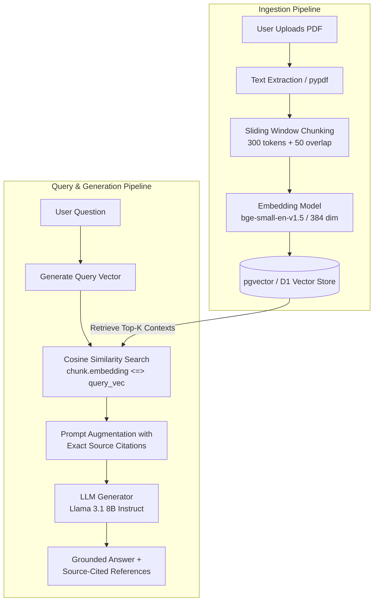

# AI Document Q&A System (RAG)

[](https://rag.shreeharsha.online)
[](https://github.com/ShreeharshaNL/AI-document-QA-System-RAG)
[](https://github.com/pgvector/pgvector)

An end-to-end Retrieval-Augmented Generation (RAG) platform built with **Python, FastAPI, PostgreSQL (`pgvector`), Docker, and Cloudflare Workers AI (Llama 3.1 & BGE Embeddings)**.

Allows users to upload technical and legal documents, automatically segments text into overlapping chunk embeddings, conducts sub-millisecond vector similarity search, and generates grounded answers citing specific page numbers and paragraphs.

Deployed live on Cloudflare Edge at **[https://rag.shreeharsha.online](https://rag.shreeharsha.online)**.

## RAG Pipeline Architecture



## Key Technical Capabilities

- **Sub-50ms Vector Retrieval:** Uses cosine distance indexing over dense 384-dimensional embedding spaces.
- **Hallucination Prevention:** Enforces strict prompt grounding where responses are generated strictly based on retrieved context chunks.
- **Auditable Source Citations:** Every answer references exact chunk index, page number, quoted excerpt, and mathematical similarity score.
- **Asynchronous Document Ingestion:** Non-blocking async processing for multi-page PDF documents.
- **Interactive Live Edge Interface:** Explore sample documents, run live queries, and inspect cosine similarity matches live at [rag.shreeharsha.online](https://rag.shreeharsha.online).

## Running Locally

### 1. Start Database & FastAPI Service via Docker Compose
```bash
git clone https://github.com/ShreeharshaNL/AI-document-QA-System-RAG.git
cd AI-document-QA-System-RAG

docker compose up --build
```

- FastAPI Interactive Swagger Docs: `http://localhost:8000/docs`
- PostgreSQL with pgvector: `localhost:5433`

### 2. Manual Setup
```bash
pip install -r requirements.txt
uvicorn app.main:app --reload --port 8000
```
